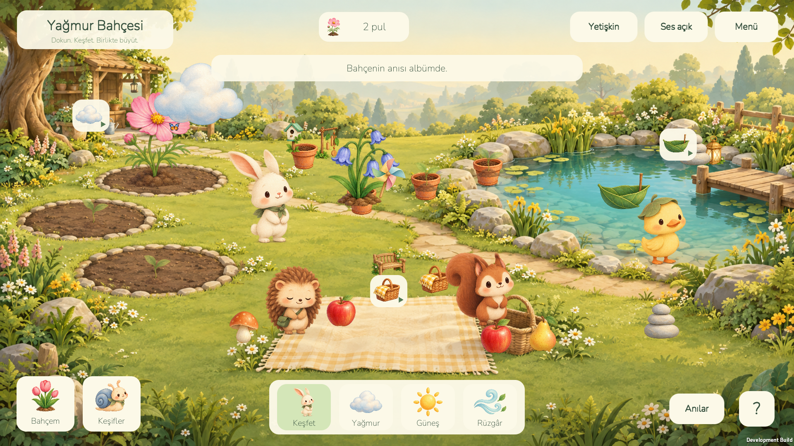

# Yağmur Bahçesi — 0.2 genişleme test paketi

Unity 6000.3.17f1 ile geliştirilmiş, 4–6 yaş için tasarlanan sakin bir bahçe oyunu. İlk hedef Android; iOS ertelendi. Bu depo ticari yayını tamamlanmış ürün değildir.

Unity/C# ile yapay zekâ desteği kullanılarak geliştirilen kişisel bir oyun prototipidir. Üç mini oyun, altı dikim alanı, çiçek/dekor koleksiyonu, pul ekonomisi ve yerel JSON kayıt sistemi içerir. Arayüz UGUI, görseller SpriteRenderer, sesler AudioSource ile çalışır; ayrı backend veya veritabanı sunucusu yoktur.



## GitHub'dan indirenler için

1. Depoyu klonla veya ZIP olarak indirip tamamen çıkar.
2. Unity Hub üzerinden **6000.3.17f1** Editor sürümünü kur. Android build alacaksan Android Build Support ve onun SDK/NDK/OpenJDK bileşenlerini de kur.
3. Hub → **Projects → Add → Add project from disk** ile içteki **YagmurBahcesi** klasörünü seç. Bu klasör Assets, Packages ve ProjectSettings içerir.
4. Editor'da **Assets/RainGarden/Scenes/Garden.unity** sahnesini aç; üstteki **▶ Play** düğmesine bas.

Bu proje Node.js uygulaması değildir; npm kurulumu veya npm run dev komutu gerekmez. Unity ilk açılışta paketleri ve asset önbelleğini hazırlar. Windows'ta standart Unity kurulum yolunu kullanıyorsan UNITY_PROJESINI_AC.cmd de projeyi açar.

**Builds klasörü Git deposuna dahil değildir.** GitHub kaynak ZIP'inde EXE/APK bulunmaz; OYUNU_AC.cmd için önce Windows build gerekir. Hazır dosyalar ayrıca paylaşılır. GitHub'a kaynak kod yüklemek oyunu tarayıcıda yayınlamaz; Web sürümü henüz hazırlanmadı. Aşağıdaki “bu bilgisayarda” yolları ve tarihli test raporları geliştirme ortamına aittir.

## Teknik inceleme ve yayın kabulü — 3 Kasım 2026

Mevcut kodun referansı ve geliştirme/test ekibi için çalışma paketi:

- [Teknik ve fonksiyonel dokümantasyon](docs/TEKNIK_VE_FONKSIYONEL_DOKUMANTASYON.md): veri modeli, ekranlar, 60 kullanıcı aksiyonu, algoritmalar ve akış şemaları.
- [112 test senaryosu ve kabul kriterleri](docs/TEST_SENARYOLARI_VE_KABUL_KRITERLERI.md), [sonuç kayıt formu](docs/QA_TEST_KAYIT_SABLONU.csv).
- [Kod denetimi ve 26 açık konu](docs/KOD_DENETIMI_VE_ACIK_KONULAR.md): çalışma kanıtı, koddan çıkarılan risk ve eksik özellik ayrımı.
- [Android release çalıştırma planı](docs/RELEASE_CALISTIRMA_PLANI.md): mevcut komutlar, production AAB/imza, cihaz kabulü ve mağaza adımları.

Bu paket mevcut kaynağın incelemesidir; 112 yeni test çalıştırılmış veya açık hatalar düzeltilmiş değildir. Önceki test sonuçlarının kapsamı belgelenmiştir. Fiziksel ARM64/16 KB çalışma testi, production AAB ve Play hesabı/mağaza süreci henüz tamamlanmadığından yayın kabulü verilmemiştir.

## Hemen oyna

Bu bilgisayarda **`OYUNU_AC.cmd` dosyasını çift tıkla**. Windows önizlemesi açılır; Unity Editor gerekmez. `Builds/Windows` klasörünün tamamı birlikte tutulmalıdır.

Unity'de açmak için [UNITY_PROJESINI_AC.cmd](UNITY_PROJESINI_AC.cmd) dosyasını kullan veya Hub'daki **YagmurBahcesi** projesini aç. Garden sahnesinde **▶ Play** ile kaynak kodun mevcut hâlini dene. OYUNU_AC.cmd son derlenmiş EXE'yi çalıştırır; kod değişince EXE/APK kendiliğinden güncellenmez.

[Kısa açılış ve paylaşım rehberi](docs/OYUNU_ACMA_VE_PAYLASMA.md), hazır Windows ZIP/Android APK bağlantılarını ve Expo Go, port ve Web önizlemesi seçeneklerini açıklar. Yeni build'leri arkadaşlara paketlemek için `tools/Prepare-SharePackage.ps1` kullanılabilir. Web çıktısı ve herkese açık oyun bağlantısı henüz oluşturulmadı.

- Bahçeye gir; buluta veya toprağa dokunarak çiçek büyüt.
- Güneş aracını seçip filize dokun; açılmış çiçeğe keşif modunda dokunarak rengini değiştir.
- Yaprak tekneyi gölete sürükle; rüzgâr aracını dene.
- Elma veya armudu piknik örtüsüne ya da hayvan dostlarına taşı.
- Karakterleri ve süsleri sürükle. Çiçek, piknik ve süs konumları kaydedilir; hayvan konumları oturumluk kalır.
- Sepet, küçük bulut ve tekne düğmelerinden üç mini oyuna gir. Her tamamlanan oyun 1 bahçe pulu verir; yarım kalan oyunlar saklanır.
- **Bahçem** ekranında 8 çiçek türü ve 12 dekoru keşfet; yeni türleri açıp altı alana dik. Açtığın içeriği yeniden kullanmak ücretsizdir.
- **Keşifler** ekranında dört projeyi ilerlet, Sumi'yi bahçeye getir. **Anılar** bölümünde son altı bahçe görüntüsünü sakla.
- Yetişkin alanında dil, ses, azaltılmış hareket, bilgi ve onaylı sıfırlama bulunur.

## Çıktılar

| Dosya | Kullanım |
|---|---|
| `Builds/Windows/YagmurBahcesi.exe` | Bu bilgisayarda oynanabilir önizleme |
| `Builds/Android/YagmurBahcesi-test.apk` | Android 8+ ARM64 test kurulumu; development modu kapalı, yerel debug imzalı |
| `Builds/Android/YagmurBahcesi-emulator.apk` | x86_64 Android emülatör testi; development modu açık |
| `YagmurBahcesi/Assets/RainGarden/Scenes/Garden.unity` | Gerçek Unity oyun sahnesi |
| `Artifacts/` | Gerçek çalıştırmalardan görüntüler ve test sonuçları |

APK dosyaları Play Store'a yüklenmiş değildir. Nihai mağaza kimliği, yayıncı bilgileri ve upload key henüz belirlenmedi.

**Bilinen masaüstü sorunu:** Oynanış kontrolleri geçse de bu bilgisayarda Windows Player normal kapanışta `UnityPlayer.dll` içinde çöküyor. Android emülatöründe test edilen akışta bu hata görülmedi. Masaüstü kapanışı düzeltilmiş sayılmıyor; ayrıntılar [raporda](docs/GELISTIRME_DURUMU.md).

## Geliştirme

PowerShell'de proje kökünden:

```powershell
.\tools\Invoke-Garden.ps1 -Action Open
.\tools\Invoke-Garden.ps1 -Action Check
.\tools\Invoke-Garden.ps1 -Action BuildWindows
.\tools\Invoke-Garden.ps1 -Action Smoke
.\tools\Invoke-Garden.ps1 -Action Smoke -Width 1280 -Height 960
.\tools\Invoke-Garden.ps1 -Action BuildAndroid
.\tools\Invoke-Garden.ps1 -Action BuildEmulator
.\tools\Test-AndroidPackage.ps1
```

Unity projesini kullanan başka bir Editor açıkken aynı proje üzerinde CLI derlemesi başlatma. Android derleme yolu Unicode kabul etmediği için script yalnızca Assets, Packages ve ProjectSettings'i `%USERPROFILE%/UnityBuilds/RainGardenAndroid` altına kopyalar; asıl proje taşınmaz. Bir dosyayı kaynak projeden bilerek sildiğinde, derleme kopyasındaki eski dosyayı da kontrollü olarak kaldırmak gerekir; eşitleme silme işlemi yapmaz.

Emülatör `%USERPROFILE%/UnityBuilds/AndroidSdk`, test AVD'si `%USERPROFILE%/UnityBuilds/Avd/RainGarden_API36.avd` altındadır. `tools/Start-AndroidPreview.ps1` ile açılabilir. `Test-AndroidGarden.ps1` yalnız bu özel test AVD'sindeki uygulama verisini sıfırlar; önce eski test kaydını Artifacts'a kopyalar. Normal oyun kaydına uygulanmaz.

Windows otomatik testleri ayrı geçici kayıt kullanır. Görüntü yakalamak için test sırasında kısa süreli görünür pencere açılır. Oyun ilerlemesi işletim sisteminin uygulama veri alanında JSON olarak tutulur; depodaki testler kişisel bilgi içermez.

## Belgeler

- [Son durum ve doğrulanmış sonuçlar](docs/GELISTIRME_DURUMU.md)
- [Oyun tasarımı](docs/GDD.md)
- [Uygulanan genişleme ve kalan içerik](docs/GENISLEME_02.md)
- [Kapsam genişletme ve tekrar oynanabilirlik önerisi](docs/KAPSAM_GENISLETME_ONERISI.md)
- [Roblox uyarlama ve yayın planı](docs/ROBLOX_UYARLAMA_PLANI.md)
- [Test planı](docs/TEST_PLANI.md)
- [Yayın hazırlığı ve dış bağımlılıklar](docs/YAYIN_HAZIRLIGI.md)
- [Pazar araştırması ve konsept seçimi](ARASTIRMA_VE_KONSEPT_ONAYI.md)

Sanat bu proje için yapay zekâ ile üretildi; prompt kayıtları `docs/ART_PROMPTS.json` ve `docs/ICON_PROMPT.txt` dosyalarındadır. Nunito fontunun lisansı `Assets/RainGarden/Fonts/OFL.txt` içindedir. Sesler proje koduyla üretildi.
